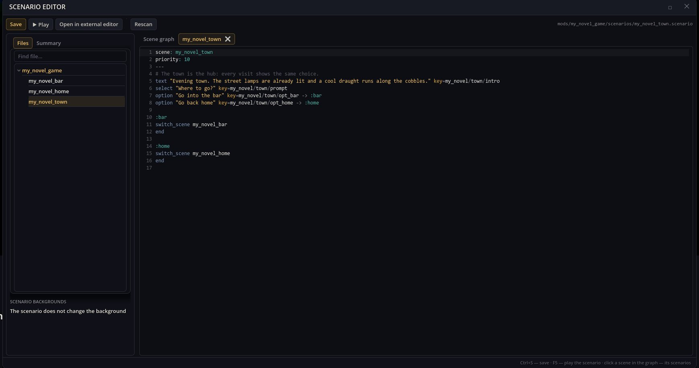

# Scenario Editor — write, check and play scenarios inside the game

The Scenario Editor edits the `.scenario` files of every installed mod while the game runs. It shows the file with highlighted scenario commands, a summary of the scenes and transitions, and a graph of where the story can go. **Play** saves the file and plays it inside the running game; Stop returns you to where you were.

## Opening it

- From the tool box: hammer button on the in-game toolbar → **Scenario Editor**.
- From the Scene Editor: select a scenario of a scene and press **Open**, or **+ New scenario** (the new file opens here).

## Working with a scenario

1. Choose the mod and the file in the **Files** tree on the left (**Summary** lists the scenes and transitions). Several files can be open in tabs.
2. Edit the text. Commands are highlighted; Ctrl+Z undoes, Ctrl+S saves into the file's own mod.
3. The **Scene graph** tab shows scenes and the transitions between them; clicking a scene lists its scenarios.
4. **▶ Play** (F5) saves and plays the scenario in the running game; the editor hides meanwhile. **■ Stop** returns to the scene the game was in and shows the editor again. The file must name its scene in the header.
5. **Open in external editor** opens the file in the program your system uses for it. **Rescan** re-reads the lists after you add files.

Saving drops the game's scenario caches, so the next time the scene is entered the new text plays. With the command palette of `schema_tools` installed, a picked command is inserted below the caret of the last focused scenario as one undo step.

## Limits

- The Validator checks cross-mod references. Modal scenario saving does not perform a full Validator pass. With `npc_barks_base` loaded, invalid ambient programs and ambient patches are refused before saving; the status line reports the compilation error.
- Only mods installed as folders can be saved. A file of a packed mod is not written, but **Play** still plays the text from the editor.

## Dependencies

`tools_base`, `scenario_tools_base`, `dialog_base`, `ui_base`.
The older `editor_tools` package installs this mod together with the other authoring windows.

## Concurrent background scenarios

`channel: ambient` runs through `npc_barks_base` outside the modal dialog queue. Each execution has its own variables, waits, roles and debugger. Scenario Editor validates/saves the source and F5 previews its buffer. Studio → Background lists definitions and runs; pause, step, breakpoints and clock advance target one execution.

[npc_barks_base](../../npc_barks_base/docs/en.md)
