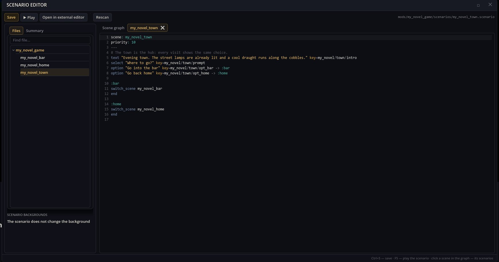

# シナリオエディター — ゲームの中でシナリオを書き、確かめ、遊ぶ

シナリオエディターはゲームの実行中に、インストール済みの全 MOD の `.scenario` ファイルを編集します。コマンドがハイライトされたファイル、シーンと遷移の概要、物語の行き先を示すグラフを表示します。**▶ プレイ**はファイルを保存して実行中のゲームで再生し、**■ 停止**で元の場所に戻ります。

## 開き方

- ツールボックスから: ゲームのツールバーのハンマーボタン → **シナリオエディター**。
- シーンエディターから: シーンのシナリオを選んで**開く**、または **+ 新しいシナリオ**（新しいファイルがここで開きます）。

## シナリオの編集

1. 左の**ファイル**ツリーで MOD とファイルを選びます（**概要**にはシーンと遷移が並びます）。複数のファイルをタブで開けます。
2. テキストを編集します。コマンドはハイライトされ、Ctrl+Z で元に戻し、Ctrl+S でファイルの属する MOD に保存します。
3. **シーングラフ**タブはシーンとその間の遷移を表示し、シーンをクリックするとそのシナリオが並びます。
4. **▶ プレイ**（F5）はシナリオを保存して実行中のゲームで再生し、その間エディターは隠れます。**■ 停止**でゲームがいたシーンに戻り、エディターが再び表示されます。ファイルのヘッダーにはシーンが必要です。
5. **外部エディターで開く**は、システムがそのファイルに使うプログラムで開きます。ファイルを追加したら**再スキャン**で一覧を読み直します。

保存するとゲームのシナリオキャッシュが破棄されるので、次にシーンに入ったときには新しいテキストが流れます。`schema_tools` のコマンドパレットがあれば、選んだコマンドが最後にフォーカスされたシナリオのカーソルの下に、1 回の取り消し単位で挿入されます。

## 制限

- Validator が MOD 間の参照を検査します。通常会話の保存では全検査は行いません。`npc_barks_base` があれば、不正な環境シナリオとそのパッチは保存前に拒否され、コンパイルエラーが状態欄に表示されます。
- 保存できるのはフォルダーとしてインストールされた MOD だけです。パックされた MOD のファイルは書き込まれませんが、**▶ プレイ**はエディターのテキストを再生します。

## 依存関係

`tools_base`、`scenario_tools_base`、`dialog_base`、`ui_base`。
古い `editor_tools` パッケージは、この MOD をほかの作成用ウィンドウと一緒にインストールします。

## 並行する背景シナリオ

`channel: ambient` は `npc_barks_base` によりモーダル会話の外で実行されます。変数、待機、役割、デバッガーは実行ごとに独立します。シナリオエディターは検証と保存、F5 はバッファーの試行を行います。Studio → Background では定義と実行を選び、個別に一時停止、ステップ、ブレークポイント、時計を操作できます。

[npc_barks_base](../../npc_barks_base/docs/en.md)
