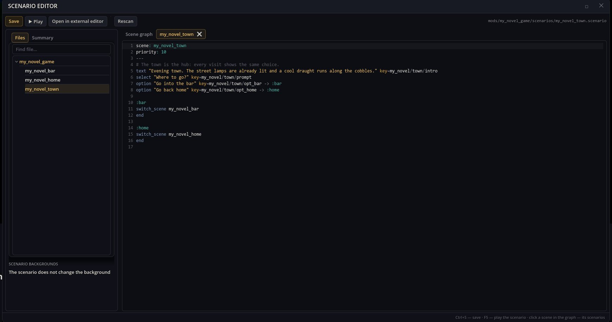

# 시나리오 에디터 — 게임 안에서 시나리오를 쓰고, 확인하고, 플레이하기

시나리오 에디터는 게임이 실행 중일 때 설치된 모든 모드의 `.scenario` 파일을 편집합니다. 명령이 강조된 파일, 장면과 전환의 요약, 이야기가 갈 수 있는 곳의 그래프를 보여 줍니다. **▶ 플레이**는 파일을 저장하고 실행 중인 게임에서 재생하며, **■ 정지**는 원래 있던 곳으로 돌아갑니다.

## 여는 방법

- 도구 상자에서: 게임 툴바의 망치 버튼 → **시나리오 에디터**.
- 장면 에디터에서: 장면의 시나리오를 고르고 **열기**, 또는 **+ 새 시나리오**(새 파일이 여기서 열립니다).

## 시나리오 작업

1. 왼쪽 **파일** 트리에서 모드와 파일을 고릅니다(**요약**에는 장면과 전환이 나열됩니다). 여러 파일을 탭으로 열 수 있습니다.
2. 텍스트를 편집합니다. 명령이 강조되며 Ctrl+Z로 되돌리고 Ctrl+S로 파일이 속한 모드에 저장합니다.
3. **장면 그래프** 탭은 장면과 그 사이의 전환을 보여 주고, 장면을 클릭하면 그 시나리오가 나열됩니다.
4. **▶ 플레이**(F5)는 시나리오를 저장하고 실행 중인 게임에서 재생하며, 그동안 에디터는 숨겨집니다. **■ 정지**는 게임이 있던 장면으로 돌아가 에디터를 다시 보여 줍니다. 파일 헤더에 장면이 적혀 있어야 합니다.
5. **외부 에디터로 열기**는 시스템이 그 파일에 쓰는 프로그램으로 엽니다. 파일을 추가한 뒤에는 **다시 검색**으로 목록을 다시 읽습니다.

저장하면 게임의 시나리오 캐시가 비워져, 다음에 장면에 들어갈 때 새 텍스트가 나옵니다. `schema_tools`의 명령 팔레트가 있으면 고른 명령이 마지막으로 포커스된 시나리오의 커서 아래에 한 번의 되돌리기 단위로 삽입됩니다.

## 제한

- 에디터는 오류가 있는 시나리오의 저장을 막지 않습니다. 깨진 참조 확인은 검증기의 몫입니다.
- 폴더로 설치된 모드만 저장할 수 있습니다. 패키지된 모드의 파일은 기록되지 않지만 **▶ 플레이**는 에디터의 텍스트를 재생합니다.

## 의존성

`tools_base`, `scenario_tools_base`, `dialog_base`, `ui_base`.
예전 `editor_tools` 패키지는 이 모드를 다른 제작 창과 함께 설치합니다.
