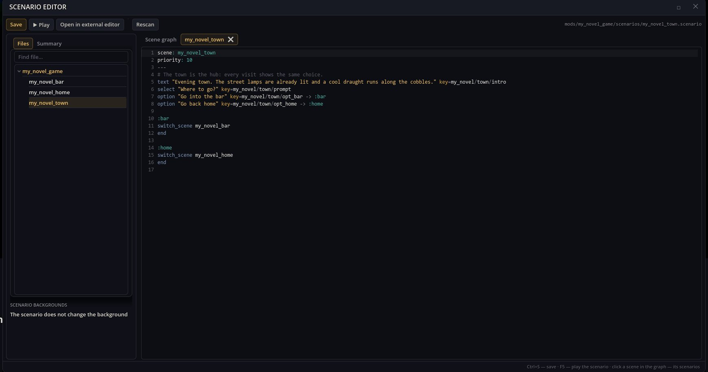

# Trình sửa kịch bản — viết, kiểm tra và chơi thử kịch bản ngay trong trò chơi

Trình sửa kịch bản sửa các tệp `.scenario` của mọi mod đã cài khi trò chơi đang chạy. Nó hiện tệp với lệnh được tô sáng, phần tóm tắt cảnh và chuyển cảnh, và đồ thị cho biết câu chuyện có thể đi đâu. **▶ Chơi** lưu tệp và chơi nó trong trò chơi đang chạy; **■ Dừng** đưa bạn về chỗ cũ.

## Cách mở

- Từ hộp công cụ: nút búa trên thanh công cụ trong trò chơi → **Trình sửa kịch bản**.
- Từ trình sửa cảnh: chọn một kịch bản của cảnh rồi nhấn **Mở**, hoặc **+ Kịch bản mới** (tệp mới mở ở đây).

## Làm việc với kịch bản

1. Chọn mod và tệp trong cây **Tệp** bên trái (**Tóm tắt** liệt kê cảnh và chuyển cảnh). Có thể mở nhiều tệp trong các thẻ.
2. Sửa văn bản. Lệnh được tô sáng; Ctrl+Z hoàn tác, Ctrl+S lưu vào mod sở hữu tệp.
3. Thẻ **Đồ thị cảnh** cho thấy các cảnh và chuyển cảnh giữa chúng; bấm vào một cảnh để xem các kịch bản của nó.
4. **▶ Chơi** (F5) lưu và chơi kịch bản trong trò chơi đang chạy; trong lúc đó trình sửa ẩn đi. **■ Dừng** quay về cảnh mà trò chơi đang ở và hiện lại trình sửa. Phần đầu tệp phải ghi cảnh của nó.
5. **Mở bằng trình sửa ngoài** mở tệp bằng chương trình hệ thống dùng cho nó. **Quét lại** đọc lại danh sách sau khi bạn thêm tệp.

Khi lưu, bộ nhớ đệm kịch bản của trò chơi bị xóa, nên lần sau vào cảnh sẽ chạy văn bản mới. Nếu có bảng lệnh của `schema_tools`, lệnh đã chọn được chèn dưới con trỏ của kịch bản được focus gần nhất, gói trong một bước hoàn tác.

## Giới hạn

- Trình sửa không ngăn bạn lưu kịch bản có lỗi; kiểm tra tham chiếu hỏng là việc của Trình kiểm tra.
- Chỉ lưu được mod cài dạng thư mục. Tệp của mod đóng gói không được ghi, nhưng **▶ Chơi** vẫn chơi văn bản trong trình sửa.

## Phụ thuộc

`tools_base`, `scenario_tools_base`, `dialog_base`, `ui_base`.
Gói cũ `editor_tools` cài mod này cùng các cửa sổ tác giả khác.
