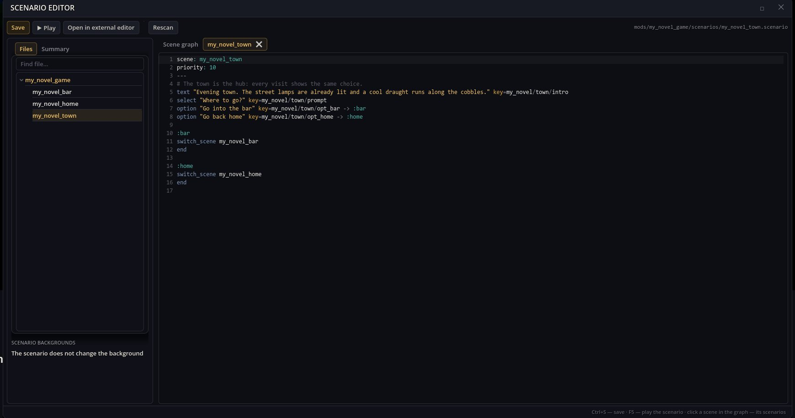

# 剧本编辑器 —— 在游戏里编写、检查和试玩剧本

剧本编辑器在游戏运行时编辑所有已安装模组的 `.scenario` 文件。它显示命令高亮的文件、场景和跳转的概要，以及故事走向的图。**▶ 试玩**保存文件并在运行中的游戏里播放；**■ 停止**让你回到原来的位置。

## 打开方式

- 从工具箱：游戏工具栏上的锤子按钮 → **剧本编辑器**。
- 从场景编辑器：选中某个场景的剧本，按**打开**，或按 **+ 新剧本**（新文件会在这里打开）。

## 编辑剧本

1. 在左侧的**文件**树中选择模组和文件（**概要**列出场景和跳转）。可以在标签页中同时打开多个文件。
2. 编辑文本。命令会高亮；Ctrl+Z 撤销，Ctrl+S 保存到文件所属的模组。
3. **场景图**标签页显示场景及其之间的跳转；点击场景会列出它的剧本。
4. **▶ 试玩**（F5）保存并在运行中的游戏里播放剧本，期间编辑器隐藏。**■ 停止**回到游戏原来所在的场景，并重新显示编辑器。文件头中必须写明它的场景。
5. **在外部编辑器中打开**用系统为该文件指定的程序打开它。添加文件后，**重新扫描**会重新读取列表。

保存会清空游戏的剧本缓存，所以下次进入该场景时播放的是新文本。如果安装了 `schema_tools` 的命令面板，选中的命令会作为一步撤销插入到最后获得焦点的剧本的光标下方。

## 限制

- 编辑器不会阻止你保存有错误的剧本；检查模组中的失效引用是验证器的工作。
- 只能保存以文件夹形式安装的模组。打包模组的文件不会被写入，但 **▶ 试玩**仍会播放编辑器中的文本。

## 依赖

`tools_base`、`scenario_tools_base`、`dialog_base`、`ui_base`。
旧的 `editor_tools` 包会把这个模组和其他创作窗口一起安装。
